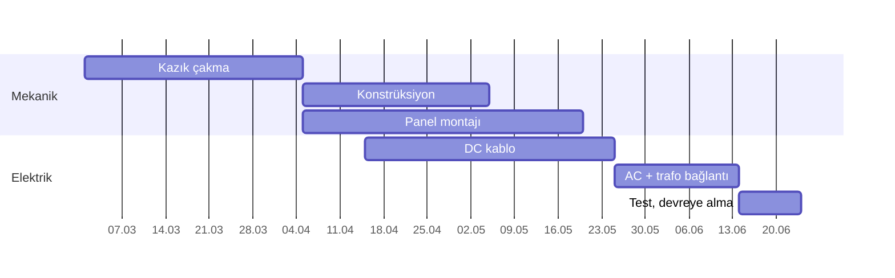

TEKLİF SUNUMU · ÖRNEK

# 50 MWp GES Mekanik + Elektrik Montaj

Takvimde, bütçede, sıfır kazayla teslim.

---
layout: two-cols
---

# Sorununuz

<v-clicks>

- Sahada **gecikme** = günlük üretim kaybı
- Ekip değişimi ve **kalite dalgalanması**
- İş güvenliği riskinin işverene dönmesi
- Belirsiz metraj → **ek fatura**

</v-clicks>

::right::

1 gün gecikme

50 MWp sahada ≈ <b>230 MWh</b> kayıp üretim*

*Örnek: 4,6 kWh/kWp/gün

---

# Neden biz

13+
yıl saha deneyimi

100+
tamamlanan proje

TR+
Türkiye ve bölge ülkeleri

Mekanik + elektrik montajı <b>tek elden</b>: kazık, konstrüksiyon, panel, DC/AC kablo, topraklama, devreye alma.

---

# Takvim: 16 hafta

---

# Bütçe — şeffaf ve sabit

| Kalem | Birim | Tutar (örnek) |
|---|---|---|
| Mekanik montaj | €/kWp | 0,028 |
| Elektrik montaj | €/kWp | 0,022 |
| Test & devreye alma | götürü | dahil |
| **Toplam** | | **€2,5 M** |

Metraj sabit: <b>ek fatura yok</b>. Gecikmede günlük ceza maddesini kabul ediyoruz.

---

# Risk → Güvence

⏱ <b>Gecikme</b> Haftalık ilerleme raporu, gecikme cezası

🦺 <b>İş güvenliği</b> Sertifikalı ekip, günlük İSG kontrolü

🔧 <b>Kalite</b> Tork, kablo, topraklama testleri kayıtlı

📄 <b>Belgeler</b> As-built, test raporları teslimde hazır

---
layout: center
class: text-center
---

# Karar

İmza tarihinden <b>7 gün</b> içinde sahadayız.

Sözleşme taslağını bu hafta gönderelim

